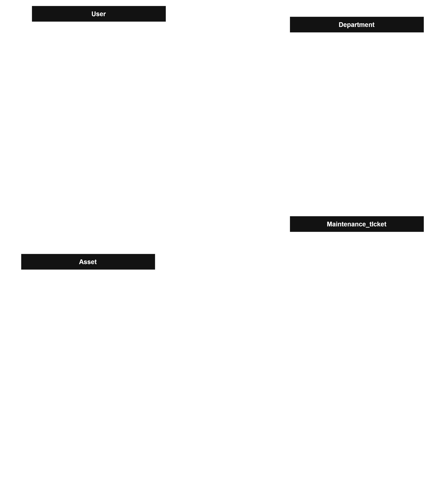

Problem : perusahaan kesulitan mengetahui data perangkat IT dan Riwayat maintenance karena data masih dicatat secara manual. hal ini merugikan perusahaan karena tidak dapat melihat perangkat tersebut apakah sudah waktu nya untuk di tinggalkan atau masih bisa diperbaiki.

Objektif : membuat aplikasi yang dapat mencatat semua perangkat IT seperti Komputer, Laptop, Printer, Router, Switch, dan perangkat IT lainnya,  mencatat Histori Maintenance yang sudah dilakukan pada perangkat IT tersebut dan juga melihat status perangkat tersebut.

Tujuan sistem:
Menyimpan informasi detail setiap aset IT.
Mencatat aktivitas maintenance.
Menyimpan riwayat maintenance setiap aset.
Menampilkan status dan kondisi aset.
Menampilkan informasi aset dan maintenance melalui dashboard.
Mengatur hak akses berdasarkan role pengguna.
Menyediakan REST API sebagai penghubung frontend dan backend.

User yang terlibat adalah : User dan Admin 
Admin	: Login, Dashboard, View Asset, View Asset Detail, Add Asset, Edit Asset, Delete Asset, View Maintenance, Add Maintenance, Edit Maintenance, View User, Add User, Edit User, Delete User
User	: Login, Dashboard, View Asset, View Asset Detail, View Maintenance

Alur utama untuk maintenance : 

USER
  │
  │ Create Ticket
  ↓
PENDING
  │
  │ Admin Review
  ├───────────────┐
  ↓               ↓
APPROVED        REJECTED
  │
  ↓
IN_PROGRESS
  │
  ↓
COMPLETED

ADMIN
  │
  │ Create Ticket
  ↓
APPROVED
  │
  ↓
IN_PROGRESS
  │
  ↓
COMPLETED

BR-01 Maintenance Ticket Approval 
maintenance dari User memerlukan approval dari Admin untuk proses maintenance
BR-02 Admin maintenance Ticket 
maintenance Ticket admin otomatis approve 

BR-03 — Ticket Immutability
Setelah maintenance ticket dibuat, User dan Admin tidak dapat mengubah atau menghapus ticket tersebut. Perubahan status dilakukan melalui workflow maintenance.

BR-04 — Maintenance Completion
Maintenance dianggap selesai ketika Admin mengubah status ticket menjadi COMPLETED.

user flow

                    ┌─────────────┐
                    │    LOGIN    │
                    └──────┬──────┘
                           │
                 ┌─────────┴─────────┐
                 ↓                   ↓
              ADMIN                USER
                 │                   │
                 ↓                   ↓
            Dashboard            Dashboard
                 │                   │
          ┌──────┼──────┐      ┌─────┼─────┐
          ↓      ↓      ↓      ↓     ↓     ↓
        Asset   User  Ticket  Asset Ticket Logout
                 │      │      │     │
                 │      ↓      │     ↓
                 │   Approval  │   Create
                 │      │      │   Ticket
                 │      ↓      │
                 │  Maintenance
                 │
                 ↓
               Logout

START
  ↓
Login Page
  ↓
Input Email + Password
  ↓
Submit
  ↓
Validasi
  │
  ├── Salah → Error Message
  │             │
  │             └──→ Login Page
  │
  └── Benar
        ↓
     Cek Role
        │
        ├── ADMIN → Admin Dashboard
        │
        └── USER  → User Dashboard

pada dasboard Admin menampilkan informasi seperti berikut :
Total Asset
Active Asset
Maintenance
Pending Ticket
Completed Maintenance    

Admin dapat memilih halaman 
Dashboard
Asset
Maintenance
Users
Profile
Logout

untuk pada halamn asset terdapat seperti berikut
Search
Filter
View Detail
Add Asset
Edit Asset
Delete Asset

Asset List
   ↓
Add Asset
   ↓
Asset Form
   ↓
Validation
   │
   ├── Invalid → Error
   │
   └── Valid
         ↓
      Save Asset
         ↓
      Asset List

asset detail menjadi 
Asset Code
Asset Name
Category
Brand
Serial Number
Location
Assigned_to 
Department
Status
Created At

assigned to menyambung ke User ID: seperti berikut
Asset LT-001
     │
     ↓
User ID: 15
     │
     ↓
Dhanu Satria

┌─────────────────────────────────┐
│ Asset Detail                    │
├─────────────────────────────────┤
│ Asset Code    : LT-001          │
│ Asset Name    : Laptop          │
│ Category      : Laptop          │
│ Brand         : Dell            │
│ Serial Number : ABC123          │
│ Location      : IT Department   │
│ PIC / User    : Dhanu Satria    │
│ Department    : IT              │
│ Status        : Active          │
├─────────────────────────────────┤
│ Maintenance History             │
│                                 │
│ 02 Oct 2026                     │
│ Battery Problem                 │
│ Completed                       │
└─────────────────────────────────┘

Admin — Maintenance Ticket

Dashboard
   ↓
Maintenance

| Ticket | Asset  | Created By | Status      |
| ------ | ------ | ---------- | ----------- |
| MT-001 | LT-001 | User       | Pending     |
| MT-002 | PR-001 | Admin      | Approved    |
| MT-003 | PC-002 | User       | In Progress |
| MT-004 | RT-001 | User       | Rejected    |

View Ticket
Approve
Reject
Start Maintenance
Complete Maintenance

User Membuat Maintenance Ticket
User
 ↓
Dashboard
 ↓
Maintenance
 ↓
Create Ticket

Asset
Problem
Description
Priority

Asset       : LT-001
Problem     : Laptop mati sendiri
Description : Laptop mati setelah digunakan ±30 menit
Priority    : HIGH

saat user klik maka ticket akan dibuat dan masuk ke pending, setelah itu user dapat melihat status ticket tersebut 

Admin Approve Ticket
admin masuk maintenance dan dapat melihat list ticket maintenance yang dibuat user, admin dapat melihat detail ticket tersebut dengan mengklik kode maintenance nya lalu admin dapat memilih approve dan reject nya

saat klik approve maka status akan berubah ke approve dan in_proggress setelah selesai diperbaiki maka admin dapat mengubah ke completed

jika admin menolaj maka tiket akan tetap tersimpan admin dapat memasukan reason mengapa tiket tersebut ditolak 

Admin dapat membuat tiket sendiri 
dengan seperti berikut : 
Maintenance
   ↓
Create Ticket
   ↓
Pilih Asset
   ↓
Isi Problem
   ↓
Isi Description
   ↓
Isi Priority
   ↓
Submit

ticket akan otomatis approved 

user hanya dapat melihat list maintenance tidak dapat mengubah, mengedit status maintenance, mengapprove dan mereject ticket

user dashboard

┌─────────────────────────────────┐
│ Dashboard                       │
├─────────────────────────────────┤
│ Total Assets          120       │
│ Active Assets          95       │
│ Maintenance            15       │
├─────────────────────────────────┤
│ My Tickets                      │
│                                 │
│ Pending               2         │
│ Approved              1         │
│ In Progress           1         │
│ Completed             5         │
└─────────────────────────────────┘
dashboard Adminnnn
┌─────────────────────────────────┐
│ Dashboard                       │
├─────────────────────────────────┤
│ Total Assets          120       │
│ Active Assets          95       │
│ Maintenance            15       │
│ Retired                 10      │
├─────────────────────────────────┤
│ Maintenance Tickets             │
│                                 │
│ Pending                5        │
│ Approved               3        │
│ In Progress            7        │
│ Completed             43        │
│ Rejected                2       │
└─────────────────────────────────┘

Jadi requirement Dashboard kita

Admin Dashboard:

Total Assets
Active Assets
Maintenance Assets
Retired Assets
Pending Tickets
Approved Tickets
In Progress Tickets
Completed Tickets
Rejected Tickets

User Dashboard:

Total Assets
Active Assets
Maintenance Assets
My Tickets:
Pending
Approved
In Progress
Completed
Rejected

ERD :

Database Schema
1. Departement
Column      Type           Constraint                 Ket
Id          BIGINT         PK                   ID departement
name        Varchar(100)   NOT NULL, UNIQUE     Nama departement
Created_at  TIMESTAMP      NOT NULL             Waktu Dibuat
Update_at   TIMESTAMP      NOT NULL             WAKTU diperbarui

2. Users
Column         Type	        Constraint	           Keterangan
id	            BIGINT	         PK	                ID user
name           VARCHAR(100)	NOT NULL	             Nama user
email	         VARCHAR(150)	NOT NULL, UNIQUE	    Email login
password	      VARCHAR(255)	NOT NULL	             Password terenkripsi
role	         VARCHAR(20)	   NOT NULL	             ADMIN / USER
department_id	BIGINT	      FK, NOT NULL	       Department user
created_at	   TIMESTAMP	   NOT NULL	             Waktu dibuat
updated_at	   TIMESTAMP	   NOT NULL	             Waktu diperbarui

3. Assets
Column         Type           Constraint           Keterangan
id	            BIGINT	      PK	ID                asset
asset_code	   VARCHAR(50)	   NOT NULL, UNIQUE	   Kode asset
name	         VARCHAR(150)	NOT NULL	            Nama perangkat
category	      VARCHAR(50)	   NOT NULL	            Laptop, Switch, Router, dll
brand	         VARCHAR(100)	NULL	               Merek
serial_number	VARCHAR(150)	UNIQUE, NULL	      Nomor serial
location	      VARCHAR(150)	NOT NULL	            Lokasi asset
assigned_to	   BIGINT	      FK, NULL	            User/PIC
department_id	BIGINT	      FK, NOT NULL	      Department
status	      VARCHAR(30)	   NOT NULL	            ACTIVE / MAINTENANCE / RETIRED
created_at	   TIMESTAMP	   NOT NULL	            Waktu dibuat
updated_at	   TIMESTAMP	   NOT NULL	            Waktu diperbarui

4. Maintenance_Ticket
Column	         Type	         Constraint	         Keterangan
id	               BIGINT	      PK	                  ID ticket
ticket_code	      VARCHAR(50)	   NOT NULL, UNIQUE	   Kode ticket
asset_id	         BIGINT	      FK, NOT NULL	      Asset yang bermasalah
created_by	      BIGINT	      FK, NOT NULL	      Pembuat ticket
approved_by	      BIGINT	      FK, NULL	            Admin yang menyetujui
status	         VARCHAR(30)	   NOT NULL	            Status ticket
priority	         VARCHAR(20)	   NOT NULL	            LOW / MEDIUM / HIGH
problem	         VARCHAR(255)	NOT NULL	            Masalah utama
description	      TEXT	         NULL              	Detail masalah
rejection_reason	TEXT	         NULL	               Alasan ditolak
completion_notes	TEXT	         NULL	               Catatan penyelesaian
started_at	      TIMESTAMP	   NULL	               Waktu maintenance dimulai
completed_at	   TIMESTAMP	   NULL	               Waktu selesai
created_at	      TIMESTAMP	   NOT NULL	            Waktu ticket dibuat
updated_at	      TIMESTAMP	   NOT NULL          	Waktu diperbarui